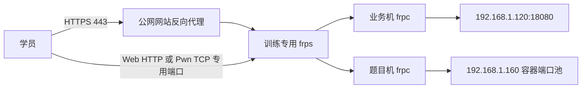

# 训练平台独立公网入口方案

适用环境：平台 `192.168.1.120:18080`，专用题目机 `192.168.1.160`；学员无需 VPN，Web 和 Pwn/TCP 都需要公网访问。公网服务器、域名由管理员提供。本次 UI 改动没有部署这些网络配置。

## 推荐分两步落地

第一步使用独立 FRP 服务承载隧道，公网 Nginx/Caddy 为平台提供 HTTPS；题目使用独立域名和一段专用 TCP 端口。可以复用现有公网主机的计算资源，但训练入口的进程、配置、认证凭据、端口、日志与比赛分开。不要覆盖比赛的 FRP 配置。

示意域名（不是已配置的实际域名）：平台 `train.example.com`，题目 `challenge.example.net`。让漏洞题目与平台使用独立的来源，平台会话 Cookie 不应发送给题目域名。普通 Pwn/TCP 服务由 nc、pwntools 等客户端连接；Web 题由浏览器打开。

第二步如需每道 Web 题都有 HTTPS 子域名，再加入 Traefik 或其他支持动态配置的反向代理，把 `实例标识.challenge.example.net` 路由到对应实例。需要泛域名 DNS、证书和实例路由同步。现有 DockerManager 不会自动生成这些路由，不能只安装 Traefik 就宣称完成。

## 工具各自负责什么

| 组件 | 职责 | 在此环境中的位置 |
| --- | --- | --- |
| FRP | 从内网主动建立隧道，把公网连接转给内网服务，支持 TCP/HTTP 等代理 | 第一阶段采用，独立于比赛 FRP |
| Nginx/Caddy | 网站域名、HTTPS 和固定服务反向代理 | 平台网站公网入口 |
| Traefik | 根据配置或服务发现管理 HTTP/TCP 路由 | 第二阶段按需采用，不能替代网络隧道 |
| WireGuard 站点互联 | 另一种把公网机与内网机连通的方式 | 若团队熟悉路由、防火墙、NAT，可以替代 FRP 隧道；学员无需加入此管理隧道 |

## 必须先补的代码：公网端口与实例生命周期

目前 `src/GZCTF/Services/Container/Manager/DockerManager.cs` 设置 `HostPort = "0"`，由 Docker 随机分配宿主端口。`PublicEntry` 只决定返回给学员的地址，不能凭空建立公网映射。

建议为训练容器预留固定端口池，例如 **30000–30999（示例，先核对占用）**，公网与内网采用相同端口。这不是映射容器内部的 8080，而是映射实例实际绑定的宿主端口。

1. 启动实例时，在事务/并发保护下领取端口，并与 Docker 实际绑定结果核对；绑定冲突重新分配。
2. FRP 将该公网端口映射到题目机同一端口。较新版本可用端口范围模板，也可以由受控服务维护单实例映射；模板会创建多个代理，需按容量评估。
3. 只有容器和入口均准备就绪，才返回公网连接地址。配置失败要清理容器与端口租约。
4. 延长只更新有效期；停止、到期、启动失败均回收资源。重启后对账，避免端口泄漏和已停止实例残留入口。
5. 测试两个学员同时开题、端口耗尽、隧道中断、服务重启、到期回收和重新分配。分配器不得在旧实例仍存活时复用端口。

第一阶段按端口直连的 Web 题通常是 HTTP；平台网站可以独立使用 HTTPS。每题 HTTPS 域名属于第二阶段的动态路由能力。

## 实施顺序

1. 确认公网主机系统、域名、证书/DNS 管理方式、训练 FRP 独立控制端口和题目端口池。对照实际 frp 版本选配置格式。
2. 先将题目容器网络与办公/管理网隔离：允许必要镜像拉取和控制连接，阻止题目容器访问 vCenter、业务数据库、Docker 控制面及办公内网。当前题目机接在 VMNet，不能把“内网已通”当作题目网络隔离已完成。
3. 将目前依赖终端的 SSH Docker socket 转发改为专用密钥和可自动重连的 systemd 服务。Docker socket 不向公网开放。
4. 发布平台 HTTPS 入口，单独验证登录、静态资源、上传和实时连接。
5. 实现并验证端口池与公网地址，再接入训练专用 FRP，先测单题再测并发。
6. 验证通过后再考虑 Web 题泛域名 HTTPS；不要把现有比赛切换到新入口。

现阶段不需要为了本次界面改动更换 Docker、Harbor 或比赛平台。

## 官方资料

- [FRP 配置文件与基本代理](https://gofrp.org/en/docs/features/common/configure/)：0.52 起支持 TOML/YAML/JSON，INI 已弃用。
- [FRP 端口范围映射](https://gofrp.org/en/docs/features/common/range/)：0.56 起提供范围模板，每个端口生成一个代理。
- [Traefik Docker provider](https://doc.traefik.io/traefik/reference/install-configuration/providers/docker/)：路由配置、服务发现以及 Docker API 的访问边界。

- [WireGuard 官方概述](https://www.wireguard.com/)：站点间的三层隧道替代方案。
