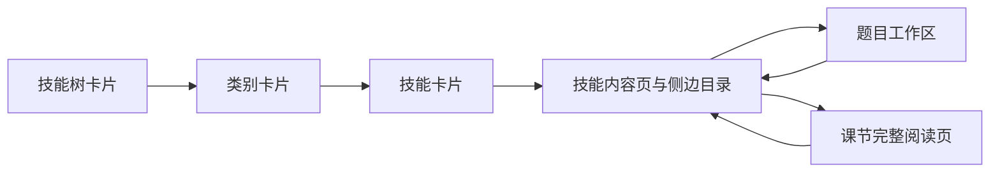
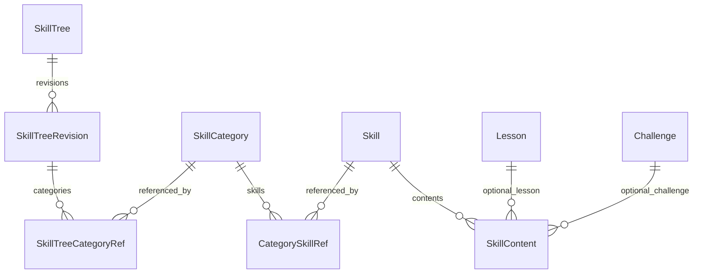

# 技能树、类别与技能四层结构改版开发文档

日期：2026-11-02

项目：NYNUCTF / GZCTF 训练平台

代码基线：`dad7a2fb`（`codex/lesson-workspace`）；设计文档分支：`codex/skill-hierarchy-design`

阶段：需求与开发设计，尚未开始本轮业务代码修改。

## 1. 已确认需求

| 项目 | 用户确认的选择 |
| --- | --- |
| 内容层级 | 技能树 → 类别 → 技能 → 题目 / 课节 |
| 技能定义 | 独立内容分组，可以编排多道题目、多篇课节 |
| 前台流程 | 三级卡片选择；进入技能后显示侧边目录和题目 / 课节 |
| 第一版信息 | 封面、简介、内容数量和个人进度 |
| 暂不实现 | 作者、学习人数、热度、热门榜单及其统计 |
| 复用 | 类别、技能、题目和课节允许跨上级引用；同一内容的通关记录共用 |
| 主题 | 延续已确认的个人配色与深色 / 浅色 / 跟随系统机制 |
| 动画 | 层级切换、卡片交互、目录展开和进度变化有连贯动效 |
| 既有功能 | 保留课节完整阅读与 Markdown 编辑、题目启动 / 延长 / 停止 / Flag / WP |

这些选择来自本轮对话中的四次明确确认。本文件将后续实现细节作为推荐设计列出，供整体评审；不代表本轮已经执行迁移或上线。

## 2. 参考站调研与适配边界

用户提供的两张截图展示了路线封面卡片、三步选择导航、技能摘要卡片。浏览器实际观察到的路线详情页为：

`http://hbc.haobachang.com/learn_route?id=1&new=1`

- 左侧为路线、类别和技能目录，可以切换路线、定位技能。
- 主区为路线简介、整体进度、类别分区以及技能折叠内容。
- “安全编码”是一组技能内容，下面包含多道编码练习，并非一道单独的题目。
- 题目入口与技能分组区分；同一技能可以展示题目数量和已完成数量。

本项目结合截图的分步发现流程和链接的目录式学习体验。复用布局组织及交互规律，封面使用本平台上传资源或本地默认图；不依赖参考站图片 URL、账号、学习数据或运行接口。

浏览器页面读取连接曾出现超时，已通过原生浏览器界面确认上述结构。下文动画时长是本项目的设计规格，不声称是参考站动画的实测值。

## 3. 用户流程与页面

### 3.1 技能树选择

- 页面标题“选择学习路线”，顶部步骤为“选择路线 / 选择类别 / 选择技能”。菜单入口仍叫“技能树”，本轮不全站重命名。
- 每张卡片显示横向封面、名称、简介、类别 / 技能 / 题目 / 课节数量；登录后显示个人完成数量与比例。
- 桌面优先四列；中等宽度两至三列；手机单列。按实际可用宽度布局，不为凑四列挤压正文。
- 封面统一 16:9；正文等高，长标题允许两行，简介最多三行；学习状态靠底部对齐。
- 整卡可点击，键盘可聚焦；不在整卡链接内嵌套其他按钮。
- 无封面使用本地主题适配默认图；空列表显示创建或等待发布提示。

### 3.2 类别选择

- 标题“选择分类”，显示已选技能树名称和简介；可返回路线选择。
- 类别卡片显示图标、名称、简介、技能数量、可学习内容数量与个人完成情况。
- 卡片尺寸、圆角、边框和状态标记继承同一套组件规范。
- 不将“技能”和“题目”混作同一数量：分别标注“X 项技能 / Y 道题 / Z 篇课节”。

### 3.3 技能选择

- 标题“选择具体技能”，明确当前位置为“技能树 / 类别”。
- 技能卡片显示图标、名称、简介、题目数、课节数、个人完成数。
- 状态为“未开始 / 学习中 / 已完成”；零内容技能显示“暂无内容”，不显示 100% 或已完成。
- 不展示假的热度、作者和学习人数占位数字。
- 点击卡片进入技能内容页，不自动启动容器、不自动标记课节完成、不强制按顺序解锁。

### 3.4 技能内容页与侧边栏

- 左侧显示当前路线下的类别与技能，可折叠并标记当前技能、完成状态；使用当前路线的引用顺序。
- 主区显示技能名称、简介、进度及有序内容列表。列表混排课节和题目，用图标与类型标签明确区分。
- 每个题目显示标题、难度、预计用时、完成状态；每篇课节显示标题、类型和完成状态。
- 切换技能不清除同一路线内的目录展开状态；重新加载可恢复当前 URL 所确定的技能。
- 手机侧栏改为可关闭的目录抽屉；点击目录项后关闭抽屉，将焦点交给新内容标题。
- 错误页保留返回入口和重试；失效或无权访问的内容不回显正文。

### 3.5 课节与题目工作区

- 课节保持上一轮已完成的完整阅读页，目录调整为“类别 → 技能 → 课节 / 题目”。
- 题目继续复用既有工作区，可保持弹窗形态；其背景和关闭返回目标为所属技能内容页。
- 课节上一项 / 下一项按当前技能的内容排序移动；到边界停止，不隐式跳入另一条技能。
- 侧栏可主动选择其他技能。相同课节在不同技能中打开时，导航上下文不同，课节正文和学习记录相同。
- 本轮不重写 Markdown 编辑器、容器控制通道、Traefik、Harbor 或校园网端口策略。

## 4. 路由与导航契约

以下为新路由建议，实施时保持 URL 中明确的实体 ID，不用名称作为唯一键。

| 页面 | 路由 |
| --- | --- |
| 路线列表 | `/skill-trees` |
| 某路线的类别 | `/skill-trees/:treeId` |
| 某类别的技能 | `/skill-trees/:treeId/:categoryId/skills` |
| 技能内容页 | `/skill-trees/:treeId/:categoryId/skills/:skillId` |
| 技能内课节 | `/skill-trees/:treeId/:categoryId/skills/:skillId/lesson/:contentId` |
| 技能内题目 | `/skill-trees/:treeId/:categoryId/skills/:skillId/challenge/:contentId` |

- 浏览器前进、后退、刷新和复制链接均恢复相应选择；URL 是选择状态的来源，不能仅保存在组件内存。
- 三步导航可回到已到达的上级：返回路线列表不保留旧路线的下级选择；更换类别清除原技能选择。
- 旧 `?category=:id` 地址兼容到对应类别技能页。
- 旧 `/skill-trees/:treeId/:categoryId/:kind/:contentId` 地址通过该类别内有效技能引用解析。多处引用时按技能引用的 `SortOrder`、再按技能 ID 确定稳定目标，不能随机跳转。
- 旧链接找不到当前可访问引用则按既有权限返回拒绝或 404，不扩大公开范围。
- 新 URL 必须同时验证路线、类别、技能和内容的引用关系，不能只检查最后一个内容 ID。

## 5. 后台管理

### 5.1 技能树与类别编排

- 技能树新增封面上传 / 更换 / 恢复默认，沿用标题、简介、图标、类别排序和发布流程。
- 类别编辑页面改为管理“技能引用列表”，支持关联现有技能、创建技能、取消关联与排序。
- 现有类别跨技能树复用保持有效；排序属于父子引用，不属于被复用实体本身。
- 发布预览展示完整四层结构，提示空技能、失效引用和不可学习内容。

### 5.2 新增技能库

- 支持搜索、按关联类别筛选、新建、编辑、启用 / 停用和删除影响预览。
- 字段：名称、简介、图标；第一版封面用于路线卡片，不额外给所有技能添加封面编辑负担。
- 技能详情显示全部引用位置，可打开对应路线 / 类别检查效果。
- 在技能内从题目库、课节库选择已有内容，支持混合排序、取消关联；同一技能内不允许相同 `(内容类型, 内容ID)` 重复。
- 新建技能之后直接进入内容编排；关联已有技能不复制其中的题目、课节或 Flag。
- 拖拽排序同时提供上移 / 下移按钮，键盘和触屏均可操作；保存顺序使用服务端并发版本校验。

### 5.3 题目与课节发布

- 发布位置选择从“选类别”升级为“选技能树 → 类别 → 技能”。最终提交去重后的技能 ID。
- 支持在当前位置内联新建技能，再把当前题目 / 课节放入其中。
- 勾选复用技能时列出受影响的其他引用位置，明确一次修改会影响多处展示。
- 题目编辑、课节编辑与发布位置选择彼此分工：内容库保存正文，编排器保存引用和顺序。
- 不新增“保存即启动实例”等副作用；课节已发布正文保存行为仍按上一轮提示执行。

## 6. 数据模型建议

保留 `SkillTree`、`SkillTreeRevision`、`SkillTreeCategoryRef`、`SkillCategory`。新增以下实体：

| 实体 | 关键字段 | 作用 |
| --- | --- | --- |
| `Skill` | Id、Name、Summary、IconKey、IsEnabled、CreatedAtUtc、UpdatedAtUtc、DeletedAtUtc、RowVersion | 可复用的技能定义 |
| `CategorySkillRef` | Id、CategoryId、SkillId、SortOrder | 类别引用技能并独立排序 |
| `SkillContent` | Id、SkillId、LessonId?、ChallengeId?、SortOrder、CreatedAtUtc | 技能引用有序内容 |
| `SkillTree.CoverHash` | 可空的本地图片资源 Hash | 路线封面 |

约束：

1. `Skill` 名称最长 128，简介最长 1024，图标沿用现有白名单；同名不等于同一技能，使用稳定 ID 引用。
2. `(CategoryId, SkillId)`、`(CategoryId, SortOrder)` 唯一。
3. `(SkillId, SortOrder)` 唯一；每条内容引用必须且只能设置 LessonId 或 ChallengeId 之一。
4. `(SkillId, LessonId)`、`(SkillId, ChallengeId)` 分别建立过滤唯一索引。
5. 内容与引用使用受限删除，取消关联不删除被引用内容；技能删除走现有软删除与影响确认惯例。
6. 技能引用内容不能绕过内容自身发布状态、启用状态或既有访问控制。
7. 技能本身不另造一套发布快照：与当前类别复用规则一致，通过路线的发布引用可见。对已发布位置的共享修改必须显示影响提示。

实体关系：

## 7. 统计与个人进度

- 以 `(Kind, ContentId)` 标识内容；题目与课节 ID 相同也不能混为一项。
- 技能进度：已完成可学习内容数 / 该技能当前可学习内容总数。
- 类别、路线进度：对其下所有可学习内容按上述键去重后计算，不能直接累加技能分母或平均技能百分比。
- 题目完成沿用现有解题记录；课节完成沿用现有 LessonProgress。迁移不新建或覆盖学习记录。
- 同一内容出现在多个技能时，完成一次，各引用位置都显示完成；不同容器实例不产生多份课程完成记录。
- 零内容的技能 / 类别 / 路线显示 0 项、暂无内容或尚未开始，不显示已完成。
- 未登录用户可看到允许公开的路线元信息和内容数量，个人进度提示登录；不把匿名用户显示为已加入学习。
- 隐藏、停用或撤销发布的内容从当前可学习分母中排除，历史解题 / 完课记录保留。
- 内容增删可能改变当前进度比例，这是集合变化，不是撤销历史成绩。
- 公共目录与个人进度分开返回、分开缓存；个人接口使用当前身份，不接受任意用户 ID 查询。

验算样例：技能 A 含题目 X、课节 Y；技能 B 含课节 Y、题目 Z。A、B 均属于类别 C。C 的总内容数为 3，不是 4；完成 Y 后，A 和 B 均为 1/2，C 为 1/3。

## 8. API 改动面

以下接口为拟定契约，名称和请求字段应在实施开始前保持一致。

| 接口 | 说明 |
| --- | --- |
| `GET /api/skill-trees` | 路线卡片：新增封面 URL、技能数量；保留既有数量字段 |
| `GET /api/skill-trees/{treeId}` | 发布目录：类别、技能摘要及有序引用，公共字段不含个人状态 |
| `GET /api/skill-trees/{treeId}/categories/{categoryId}/skills/{skillId}` | 校验当前引用关系后返回技能内容摘要 |
| `GET /api/my-learning/skill-trees/{treeId}` | 返回本人的内容状态及路线 / 类别 / 技能聚合进度 |
| `GET/POST /api/admin/skills` | 管理端技能库查询 / 创建 |
| `GET/PUT /api/admin/skills/{skillId}` | 技能元信息查询 / 更新，更新携带 RowVersion |
| `PUT /api/admin/skills/{skillId}/contents` | 保存完整有序内容引用，原子提交 |
| `PUT /api/admin/skill-categories/{categoryId}/skills` | 保存类别的完整技能引用及顺序，原子提交 |
| `GET /api/admin/skills/{skillId}/delete-impact` | 删除 / 停用前列出引用及内容影响 |
| `DELETE /api/admin/skills/{skillId}` | 软删除；有影响时使用明确确认及并发版本 |

发布接口扩展 `SkillIds`，最终以后者为内容发布位置的主依据。旧 `CategoryIds` 写入请求不能在一个类别含多个技能时猜测位置：兼容期返回明确的 409 `skill_selection_required`，提示刷新页面并选择技能；只有一项有效技能的旧请求才可无歧义转换。

- 公共摘要不携带题目运行密钥、Flag、WP 正文、草稿正文或注册表凭证。
- 服务端必须验证提交的引用 ID，不相信客户端过滤结果。
- 共用技能、类别的变更要使所有受影响路线的目录和统计缓存失效。
- 列表统计批量查询，不逐卡查询每个技能的题目和学习记录。
- 获取公开摘要不自动创建报名、学习进度或实例。
- 在最终技能内容页延迟读取正文，避免为发现页下载整条路线的全部课节和题目正文。

## 9. 旧数据迁移与兼容

当前真实模型为 `SkillCategory → CategoryContent → Lesson / Challenge`，不是已有四层结构。迁移必须可核对，不能通过 UI 分组假装完成。

1. 更新前生成数据库和配置备份，记录类别内容引用、题目 ID、课节 ID、排序及学习记录数量。
2. 新增技能和引用表、封面字段；不修改题目 / 课节 ID、解题记录或实例关联。
3. 每个有内容的旧类别创建一个迁移技能，名称初始沿用该类别名称，简介和图标沿用原值，后台可再细分 / 改名。
4. 建立该类别与迁移技能的引用；同一个旧类别被多条路线引用时，只创建一个技能并继续共享。
5. 将每条 CategoryContent 转成 SkillContent，保持内容 ID、类型及原排序。迁移映射记录旧类别、旧引用与新技能 ID，避免重复执行时重复建组。
6. 没有内容的旧类别不凭空生成教学内容；后台可创建技能，前台保留清晰空状态。
7. 校验：迁移前后有效内容去重集合完全相同，顺序相同；全站题目 / 课节总数及既有完成记录不变。
8. 新服务以 SkillContent 为唯一编排来源。兼容期旧 CategoryContent 表只读保留，不做双写或双向同步；下一次清理版本再删除。
9. 老链接通过新引用解析；旧版管理端不能继续往已废弃的类别内容表写数据。
10. 有新技能编排后，不提供会丢失多技能归属的自动反向降级迁移。失败恢复使用更新前快照与匹配的旧镜像，不直接让旧镜像读取新结构。

在独立测试数据库先验证“有数据升级”，再验证空库安装；不能只依靠空库通过来证明升级安全。

## 10. 封面资源

- 后台通过已有文件 / 图片基础设施上传路线封面；校验文件内容与实际图片类型，不只校验扩展名。
- 第一版接受 JPEG / PNG / WebP，单文件不超过 5 MB，拒绝 SVG 与可执行内容；服务端生成统一缩略图，卡片按 16:9 裁切。
- 上传失败不清除当前封面；恢复默认只解除当前引用。共享图片仍有引用时不可直接物理删除。
- 图片 URL 使用内容 Hash，实现缓存版本更新；设宽高避免布局跳动，视口外延迟加载。
- 默认封面随主题保持对比度；图片本体无需跟随强调色重染，选中边框和交互反馈跟随主题。

## 11. 主题与动画规格

### 11.1 主题

- 使用已有 Mantine 主题和 `--hbc-*` 语义变量，禁止在页面局部重新写死主色。
- 优先级保持：个人自选色 / 显式默认色 / 平台托管色；三种选择均需实测。
- 背景、卡片、边框、文字随深浅模式变化；按钮、链接、选中边框、步骤和进度使用当前强调色。
- 完成绿、错误红等语义色可保留，但不能仅靠颜色传达状态。
- 正文与常规小字对比度至少 4.5:1；焦点与非文字关键边界至少 3:1。

### 11.2 动画

| 场景 | 行为 | 时长 / 约束 |
| --- | --- | --- |
| 卡片悬停 | 上移 3px、轻阴影、主题色边框；封面最多放大到 1.02 | 160–200ms，键盘焦点有等价反馈 |
| 层级进入 | 新网格淡入并轻微上移 8px | 200–240ms |
| 网格出现 | 卡片按顺序轻错峰 | 每项约 24ms，总延迟上限 120ms，不随长列表无限增长 |
| 步骤切换 | 当前步骤颜色与连接线平滑变化 | 180ms |
| 技能 / 目录展开 | 箭头旋转、内容区域展开，不保留隐藏焦点 | 180–220ms |
| 进度更新 | 进度条从旧值过渡到新值 | 240ms，只在真实状态变化时执行 |
| 移动目录 | 抽屉滑入、遮罩淡入 | 200ms；关闭后恢复触发按钮焦点 |

- 优先使用 opacity / transform，避免大面积滤镜、无限光效、背景粒子和持续晃动。
- 长列表不得为播放动画阻塞点击、滚动或接口请求；返回上一级不强制重播整页动画。
- `prefers-reduced-motion: reduce` 下去除位移、错峰及数值补间，保持即时状态反馈。
- 动画期间取消、返回、连点和快速换路线，不得显示旧路线的技能或触发重复报名 / 实例启动。

## 12. 错误、权限与并发

- 仍以当前已发布路线和有效引用判断可见性；新技能层不能使草稿内容因被引用而自动公开。
- 共享技能修改显示所有受影响位置；删除分为“取消当前位置引用”和“删除技能”，不能混为一个按钮。
- 软删除实体保留审计及历史学习记录；运行中容器生命周期沿用现有规则，不因目录项取消关联而批量误删。
- 元信息、引用排序均使用现有 RowVersion 乐观并发；冲突返回 409，保留用户当前编辑并提示重载。
- 目录获取失败、个人进度获取失败、内容加载失败分别显示；个人进度失败不把公共目录变成空列表。
- 图片和 Markdown 按现有安全策略处理；详情页对 XSS 与权限绕过进行回归。

## 13. 开发拆分与涉及文件

| 阶段 | 工作 | 主要代码位置 | 完成条件 |
| --- | --- | --- | --- |
| 1 | 技能模型、约束与数据迁移 | `Features/SkillTrees/Domain/SkillTreeModels.cs`、`Infrastructure/SkillTreeModelConfiguration.cs`、EF migrations | 有数据迁移与去重校验通过 |
| 2 | 技能 CRUD、引用、发布、进度与缓存 | `Features/SkillTrees/Application/*`、`Api/*`、`Features/LearningPaths/Application/*` | 共享、权限、并发、统计集成测试通过 |
| 3 | 后台技能库与编排器、封面上传 | `ClientApp/src/pages/admin/*`、`components/admin/skill-trees/*`、`ContentPublishModal.tsx` | 可完整创建并发布四层结构 |
| 4 | 三级卡片与新路由 | `pages/skill-trees/*`、`SkillTreeCard.tsx`、`SkillTreeOutline.tsx` | 前进 / 返回 / 刷新 / 老链接正确 |
| 5 | 技能工作区与课节目录适配 | `SkillTreeContentWorkspace.tsx`、`LessonReader.tsx`、`ChallengeWorkspace.tsx` | 内容复用且上下文导航正确 |
| 6 | 主题、动画、可访问性和移动端 | 共享主题与上述组件 CSS / hooks | 深浅色、自选色、减少动画和窄屏通过 |
| 7 | 集成验收与离线更新文档 | 后端 / 前端测试、部署文档 | 同一构建产物通过升级与功能验收后再打包 |

本轮输出为开发文档；实施阶段再将上述拆分细化为可执行任务，不在未实现时预先发布镜像或声称已完成迁移。

## 14. 验收清单

### 结构与复用

- [ ] 能创建路线 A / B、类别 C / D、共享技能 S 及题目 X、课节 Y。
- [ ] S 同时放入 C / D，X 同时放入 S / T；内容不复制，排序互不干扰。
- [ ] 单独取消一条引用不删除其他位置的实体、正文、Flag 或学习记录。
- [ ] 修改共享技能前可看见受影响位置，保存后各引用位置一致。

### 前台与进度

- [ ] 依次选择路线、类别、技能，步骤导航和数量一致。
- [ ] 技能内容页有侧边目录、题目 / 课节区分，能返回和切换。
- [ ] 每个新 URL 可直接打开、刷新和分享；旧 URL 能稳定解析。
- [ ] 完成一项后全部引用位置同步；跨技能重复内容在类别 / 路线内只计一次。
- [ ] 空技能、匿名用户、未发布内容、禁用内容及失效 ID 均有确定结果。
- [ ] 原有题目启动 / 延长 / 停止 / Flag / WP 和课节编辑 / 完成不回退。

### 主题、动画与设备

- [ ] 1440px、1024px、768px、390px、320px 下无页面横向溢出，长标题与代码块可用。
- [ ] 自选色、显式默认色、平台色均在卡片、步骤、目录、进度及工作区生效。
- [ ] 深色、浅色、跟随系统切换无固定色残留、文字消失或状态误判。
- [ ] 减少动画设置有效；纯键盘能选择、返回、展开、排序和关闭抽屉。
- [ ] 快速连续切换路线与类别、浏览器后退和慢接口场景不会展示错层内容。

### 数据与升级

- [ ] 用当前版本的带数据数据库升级，引用、排序、题目 / 课节 ID 和历史完成记录保持。
- [ ] 验证共享技能删除影响、乐观并发冲突及公共 / 个人缓存隔离。
- [ ] 验证封面上传成功、失败、替换与默认图；不依赖外部图片站。
- [ ] 升级包保留 SMTP、Harbor、SSH 隧道、Traefik 和现有 `33000–33199/TCP` 配置。
- [ ] 原比赛平台使用的 `30000–32767 → 192.168.1.153` 规则不属于本次改造范围。

## 15. 评审结论与实施边界

四层层级、两种页面结合、第一版展示字段和复用规则已经用户确认。本文件建议以“可复用技能实体 + 两级引用编排 + 主题感知的分步卡片与目录工作区”实现，避免仅改文案却让后台数据仍停留在三层结构。

下一步是整体评审本文中的页面、迁移、进度及动画规格，然后制定实现计划。没有通过实际迁移测试和完整功能验收之前，不替换线上平台，不调整校园网访问配置。
